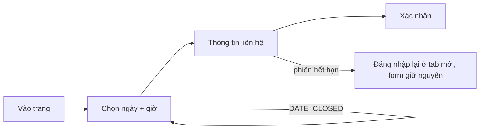

# Thiết kế UX — <tên tính năng>

> Chép sang `docs/design/<YYYY-MM-DD>-<ten>-ux.md`. Người viết: `nha-thiet-ke`. Đầu vào: spec
> `docs/specs/<…>-design.md` (nhất là bảng mã lỗi). Đầu ra cho: `giam-doc-sang-tao` → `ky-su-giao-dien`.

## 1. Người dùng & bối cảnh

| Vai | Bối cảnh | Mục tiêu (một câu) | Thiết bị chính |
|---|---|---|---|
| Khách | lướt điện thoại buổi tối, một tay | đặt bàn cho 4 người tối thứ Bảy | điện thoại 390px |
| Lễ tân | đứng quầy, đang nghe điện thoại khách | nhập đặt bàn trong lúc khách còn trên máy | máy bàn 1440px |

## 2. Luồng

- Luồng chính: <n> bước, <m> lần bấm. Mỗi bước tồn tại vì: <…>
- Nhánh: huỷ · quay lại · F5 giữa chừng · phiên hết hạn · mất mạng (N48).

## 3. Phân cấp mỗi màn

**Màn <tên>:** việc chính: <một nút> · việc phụ: <…> · thông tin tham khảo: <…> · KHÔNG đặt ở màn này: <…>

## 4. Ma trận trạng thái

| Màn \ Trạng thái | Đang tải | Rỗng (lần đầu) | Rỗng (do lọc) | Lỗi tải | Lỗi gửi | Thành công | Một phần | Không quyền | Mất mạng |
|---|---|---|---|---|---|---|---|---|---|
| <màn 1> | khung xương đúng bố cục | "Chưa có … — <hành động>" | "Không khớp bộ lọc — Xoá lọc" | | xem mục 5 | | | | |

Ô không áp dụng: ghi "—: <vì sao>".

## 5. Chữ & câu lỗi

| `error.code` (từ spec) | Câu hiển thị (ngôn ngữ gốc) | Focus vào | Hành động tiếp |
|---|---|---|---|
| `DATE_CLOSED` | "Nhà hàng nghỉ ngày này. Chọn ngày khác nhé." | ô Ngày | gợi ý 3 ngày gần nhất còn chỗ |
| `RATE_LIMITED` | | | |

Nhãn & gợi ý mới: <danh sách key → câu> · Câu dài nhất: "<…>" — đã thử ở <ngôn ngữ dài nhất>, 320px (N51, N52).

## 6. Tiếp cận

- Cặp màu cần kiểm tương phản (giao `giam-doc-sang-tao`): <chữ trên nền nào, viền ô nhập, chữ trên ảnh>
- Thứ tự focus: <đánh số theo wireframe>; dialog: focus vào khi mở, trả về nút mở khi đóng.
- Lỗi form: tóm tắt trong vùng `aria-live="polite"`; ô lỗi có `aria-invalid="true"` + `aria-describedby` → câu lỗi.
- Vùng chạm: <các nút nhỏ cần nới tới 44×44 / tối thiểu 24×24>
- Không mang nghĩa chỉ bằng màu: <…>

## 7. Wireframe

`docs/design/prototypes/<ten>-wireframe.html` (xám, không màu thương hiệu) — hoặc link Figma nếu `CLAUDE.md` chỉ Figma.

## 8. Câu hỏi chính sách phát sinh

- Q1 <…> — chờ chủ dự án (N57)
